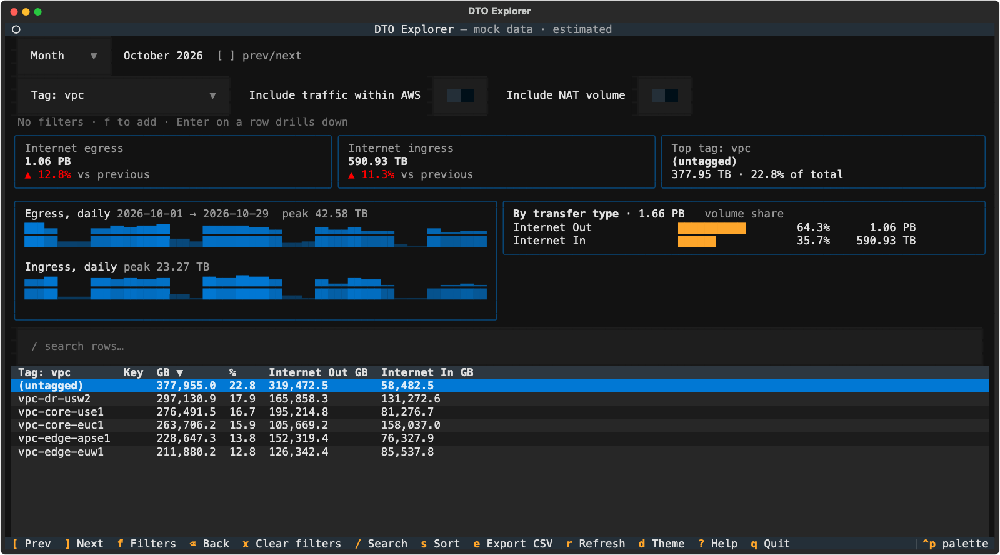

# DTO TUI

A terminal UI that totals **AWS data transfer volume** (GB) for a week, a month or a custom date range. By default it shows traffic to and from the internet: egress leaving AWS and ingress arriving in AWS. A switch adds traffic that stays on AWS's network (inter-AZ, inter-region and to CloudFront). It breaks the volume down by region, account, direction, transfer type, service, usage type, cost allocation tag (for example a VPC tag) or cost category. It reports volume only, not cost.

It's a single self-contained Python script ([`dto_tui.py`](dto_tui.py)) built on [Textual](https://textual.textualize.io/) and boto3, with AWS Cost Explorer as the data source. It's a terminal port of the [DTO Explorer](https://github.com/zscclabs/dto-explorer) web app and gives the same numbers.



## Features
- **Periods:** weekly (Monday–Sunday) or monthly with previous/next navigation, or a custom range with presets (last 7/30/90 days, year to date, last 12 months)
- **Headline numbers:** internet egress and ingress volume (plus transit inside AWS when shown), each with the change against the previous period of the same length, plus the top contributor
- **Charts and table:** egress and ingress sparklines, share by transfer type, and a sortable, searchable table with drill-down
- **Filters:** account, region, direction and transfer type, plus drill-down filters on any dimension
- **Other:** CSV export, [Include traffic within AWS](#internet-traffic-by-default) and [Include NAT volume](#avoiding-double-counting) switches, and a mock-data mode that needs no AWS account

## Quick start
You need [uv](https://docs.astral.sh/uv/). The script declares its dependencies inline ([PEP 723](https://peps.python.org/pep-0723/)), so uv installs them on first run, and you can copy the file anywhere.

```bash
curl -O https://raw.githubusercontent.com/zscclabs/dto/main/dto_tui.py

uv run dto_tui.py --mock --tag-key vpc          # synthetic data, no AWS needed

aws sso login --profile my-profile               # or any other way of getting credentials
uv run dto_tui.py --profile my-profile           # real data
```

Start in a particular view from the command line:
```bash
uv run dto_tui.py --period custom --start 2026-07-01 --end 2026-09-30 \
  --group-by LINKED_ACCOUNT --filter REGION=us-east-1 --filter TAG:vpc=prod
uv run dto_tui.py --group-by DIRECTION --include-aws-internal --include-nat-volume
```
Filters for the same dimension are OR'd and different dimensions are AND'd. An empty tag value (`TAG:vpc=`) means untagged. Run `uv run dto_tui.py --help` for every option.

### Keys
| Key | Action |
|---|---|
| `[` / `]` | Previous / next period |
| `f` | Filters (account, region, direction, transfer type) |
| `Enter` | Drill into the selected row |
| `Backspace` | Back out of the last drill-down |
| `x` | Clear filters |
| `/` | Search rows |
| `s`, or click a header | Sort |
| `e` | Export CSV to the current directory |
| `r` | Clear the cache and refresh |
| `d` | Light / dark theme |
| `?` | Help |
| `q` | Quit |

`Tab` moves between the period, group-by, **Include traffic within AWS** and **Include NAT volume** controls.

### Single account vs. AWS Organization
- **Single account:** use that account's credentials. The account filter shows just that one account.
- **Organization:** use credentials for the **management (payer) account** to see every linked account. Breaking down by account then shows each account by name.

## Configuration
Each option can also come from an environment variable, which the flag overrides.

| Flag | Variable | Default | Purpose |
|---|---|---|---|
| `--profile` | `DTO_AWS_PROFILE` | – | AWS profile; otherwise the standard boto3 chain (including `AWS_PROFILE`) |
| `--mock` | `DTO_MOCK` | off | Synthetic data instead of calling AWS |
| `--cache-ttl` | `DTO_CACHE_TTL_SECONDS` | `3600` | Cache lifetime; `0` disables caching |
| `--tag-key` | `DTO_DEFAULT_TAG_KEY` | – | Tag key to group by initially (e.g. `vpc`) |
| `--ce-region` | `DTO_CE_REGION` | `us-east-1` | Cost Explorer endpoint region |

`--include-aws-internal` and `--include-nat-volume` start with those switches on.

## AWS setup

### IAM permissions
```json
{
  "Version": "2012-10-17",
  "Statement": [{
    "Effect": "Allow",
    "Action": ["ce:GetCostAndUsage", "ce:GetDimensionValues", "ce:GetTags", "ce:GetCostCategories"],
    "Resource": "*"
  }]
}
```

### Cost
Each Cost Explorer request costs **$0.01**. One view makes about 12 requests on a cold cache. Responses are cached in memory for 1 hour (`--cache-ttl`). `r` clears the cache and fetches fresh data.

### Per-VPC breakdown
Cost Explorer has **no VPC dimension**. To get a per-VPC breakdown:
1. Tag resources that generate transfer charges (NAT gateways, load balancers, EC2 instances, etc.) with something like `vpc=<name>`. An existing `Name` tag works if your resources are named after their VPC.
2. Activate that tag as a **cost allocation tag** in Billing → Cost allocation tags. In an Organization, only the management account can do this. Data appears from the activation date onward.
3. Choose **Tag: vpc** as the breakdown, or start with `--tag-key vpc`.

## How traffic is classified
The TUI finds usage types with `GetDimensionValues`, sorts them into transfer types and directions, and adds up their `UsageQuantity` (GB). It never requests cost metrics. It counts only `RECORD_TYPE = Usage` rows: credits and discounts carry no volume and would only add empty groups.

| Direction | Transfer type | Usage type pattern |
|---|---|---|
| Out | Internet Out | `*DataTransfer-Out-Bytes` (includes CloudFront edge egress) |
| Out | Inter-Region Out | `<SRC>-<DST>-AWS-Out-Bytes` |
| Out | Other Out | anything else containing `Out-Bytes`, `Out-OBytes` or `Out-ABytes` |
| In | Internet In | `*DataTransfer-In-Bytes` |
| In | Inter-Region In | `<SRC>-<DST>-AWS-In-Bytes` |
| In | Other In | anything else containing `In-Bytes`, `In-OBytes` or `In-ABytes` |
| Transit | Inter-AZ | `*DataTransfer-Regional-Bytes` |
| Transit | NAT Gateway | `*NatGateway-Bytes` (data processed) |
| Transit | To CloudFront | `*CloudFront-Out-Bytes` |

AWS doesn't charge for inbound transfer from the internet or for the receiving side of inter-region transfer, but it still reports the volume, so the TUI counts it. Filter or break down by **Direction** to separate Out, In and Transit.

### Internet traffic by default
By default the TUI counts only traffic to and from the internet: Internet Out and In, and Other Out and In. Inter-AZ, Inter-Region Out, Inter-Region In and To CloudFront stay on AWS's network, so they are hidden. They are left out of the Cost Explorer query, every total and the transfer type filter. Turn on **Include traffic within AWS** (or pass `--include-aws-internal`) to add them back. NAT Gateway keeps its own switch.

### Avoiding double-counting
The same bytes can be reported under more than one usage type. Take 100 GB that goes from an instance through a NAT gateway in another AZ out to the internet. AWS reports it as:

- Inter-AZ: 200 GB, because Inter-AZ is counted on both the sending and the receiving side
- NAT Gateway data processed: 100 GB
- Internet Out: 100 GB

That adds up to about 400 GB of usage for 100 GB that actually left AWS. The TUI handles this as follows:

- **Egress** and **Ingress** count each byte once, at the point where it leaves or enters AWS or crosses regions.
- **Transit** types move data inside AWS. Their bytes show up again under an Out or In type, or, for Inter-AZ, twice. The TUI shows them as a separate total and labels them "(transit)" in the transfer type panel.
- **NAT Gateway** volume is left out by default because it duplicates the traffic it carries, in both directions. Turn on **Include NAT volume** (or pass `--include-nat-volume`) to add it to Transit.

The CSV export (`e`) has the columns `<breakdown>, label, gb, pct` and then `gb_<transfer type>` for each transfer type.

## Development
```bash
uv sync               # dev environment (.venv) with textual, boto3 and pytest
uv run pytest -q      # tests: classification, periods, summaries on mock data, headless UI runs
uv run dto_tui.py --mock
```

The script keeps the sections of the DTO Explorer backend it was ported from (periods, cache, Cost Explorer client, mock client, models, DTO service), each labelled with its source file. When changing classification or query logic there, port the change here too. CI (`.github/workflows/ci.yml`) runs the tests on Python 3.11 and 3.13 and checks that the script runs from its inline metadata.

The version lives in `pyproject.toml` and `__version__` in `dto_tui.py`, which must match. Dependencies are listed both in `pyproject.toml` and in the script's PEP 723 header.

## License
MIT (see [LICENSE](LICENSE)).
